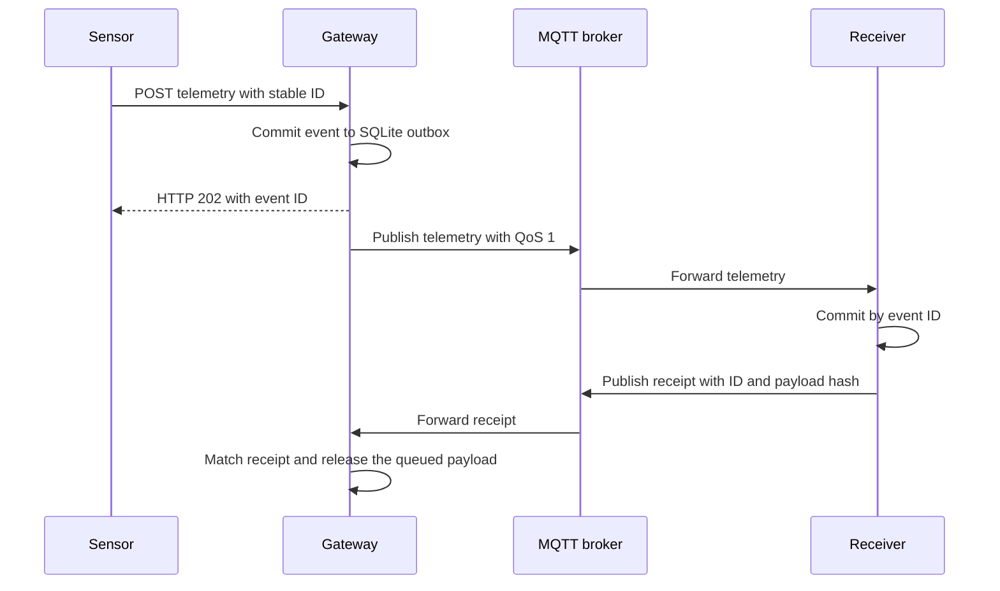

# IoT Edge Gateway

A Rust gateway that keeps accepting sensor events on the local network while
its upstream broker is offline. SQLite holds the outbox across restarts.
The receiver stores one record per event ID and issues an application
receipt after committing it.

## Run the recovery demo

On Linux, install stable Rust, a C toolchain, CMake, Python 3, and Mosquitto.
Then run this from the repo root.

```sh
cargo build --locked
python3 scripts/demo.py --report demo-report.json
```

The script starts a real Mosquitto broker on an available loopback port and
uses temporary databases. It exercises 1,000 events by default.

1. Deliver an initial batch, stop the broker, and keep sending over local HTTP.
   Fill the outbox and verify HTTP `503` with `Retry-After`.
2. Kill the gateway with `SIGKILL` and verify that its outbox survives restart.
3. Bring the broker back with receipt publishing disabled. Wait for the
   receiver to commit some events, verify that they are still pending at the
   gateway, and kill the receiver with `SIGKILL`.
4. Restart the receiver and allow receipts. Compare the complete set of
   accepted IDs and payloads with the data stored at the destination.
   Verify that the receiver saw redeliveries and stored each event once.

The JSON report includes missing IDs, duplicate deliveries, duplicate stored
records, outstanding records, and recovery time from the final broker restart
to a drained outbox. In a local run with Mosquitto 2.0.18, 968 events survived
the outage and gateway restart. All 1,000 accepted IDs were stored with matching
payloads. The receiver saw 31 redeliveries and stored zero duplicate records.
The outbox drained in 3.523 seconds after the final broker restart.

Process-crash recovery is covered by the demo. Physical
power-loss behavior depends on the target storage and needs a separate test
on the target device.

## Delivery contract



- The sender must retry an uncertain HTTP request with the same ID and content.
  An identical retry returns `202`. Reusing an ID with different content returns
  `409`. IDs must be unique within a gateway namespace. If the outbox is full
  or SQLite cannot commit a new event, the gateway returns `503`.
- The gateway keeps a payload until the receiver confirms its commit.
  MQTT PUBACK confirms the broker leg. The application receipt confirms the
  receiver commit and carries a SHA-256 payload fingerprint to match the
  pending record. The fingerprint matches content. Broker credentials and ACLs
  control who may publish receipts.
- The gateway retries unconfirmed records after a deadline and replays its
  durable outbox after reconnect. The receiver uses a unique ID constraint.
  Identical repeats produce another receipt and increment the recorded attempt
  count. MQTT QoS 1 permits duplicate deliveries.
  [MQTT delivery semantics](https://docs.oasis-open.org/mqtt/mqtt/v5.0/os/mqtt-v5.0-os.html)
- Both databases use SQLite WAL with `synchronous=FULL`. The outbox limits
  pending payloads. Delivered ID and fingerprint records stay on the gateway
  to preserve idempotency across restarts, and receiver history grows with the
  number of unique events. Plan disk space around the total event history.
  [SQLite durability settings](https://www.sqlite.org/pragma.html#pragma_synchronous)

## Try one event

Start a local Mosquitto broker on port 1883, then run the receiver and gateway
in separate terminals.

```sh
cargo run --locked -- receiver
```

```sh
cargo run --locked -- gateway
```

```sh
curl -i http://127.0.0.1:8080/v1/telemetry \
  -H 'Content-Type: application/json' \
  -d '{"id":"probe-01-0001","device_id":"probe-01","timestamp_ms":1760000000000,"metric":"temperature.c","value":23.5}'
curl -fsS http://127.0.0.1:8080/status
```

`GET /status` returns durable `accepted`, `pending` and `delivered` counts,
the configured `pending_limit`, and whether the gateway currently has an MQTT
subscription. During an outage it stays available while the gateway can
access SQLite. The POST accepts up to 4 KiB of JSON. IDs, device names and
metric names use ASCII letters, digits, dots, underscores and hyphens, starting
with a letter or digit. Their limits are 96, 64 and 64 characters respectively.
`timestamp_ms` is a nonnegative Unix timestamp in milliseconds and `value` is
a finite number.

| Environment variable | Default | Usage |
|---|---|---|
| `IOT_GATEWAY_ID` | `lab` | Set the same value on both services. Each database file belongs to its mode and gateway ID. |
| `IOT_DB_PATH` | `data/gateway.sqlite3` or `data/receiver.sqlite3` | Use a local filesystem and persistent storage for each service. |
| `IOT_HTTP_ADDR` | `127.0.0.1:8080` | Gateway HTTP address. The endpoint is intended for loopback or a trusted private sensor network. |
| `IOT_MAX_PENDING` | `10000` | Maximum pending payloads the gateway will admit. |
| `IOT_MQTT_HOST` and `IOT_MQTT_PORT` | `127.0.0.1`, `1883` | Broker address. |
| `IOT_MQTT_CA_FILE` | Unset | PEM CA certificate for a TLS broker connection. Set the broker port as well. |
| `IOT_MQTT_USERNAME` and `IOT_MQTT_PASSWORD` | Unset | Set both for broker authentication. Use TLS for credentials over the network. |

Run one gateway and one receiver per gateway ID. The gateway publishes to
`edge/v1/<gateway-id>/telemetry` and subscribes to
`edge/v1/<gateway-id>/receipt`. The receiver uses the inverse permissions.
For a shared broker, give the services separate credentials and restrict them
to those permissions with broker ACLs.

## Verify

```sh
cargo fmt --check
cargo clippy --locked --all-targets -- -D warnings
cargo test --locked
cargo build --locked
python3 scripts/demo.py
```
